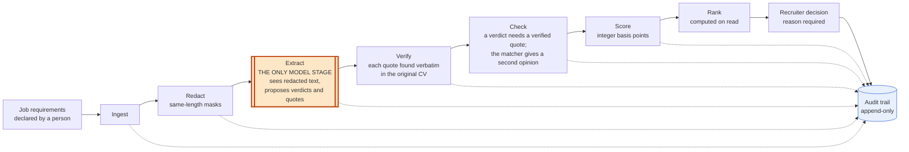
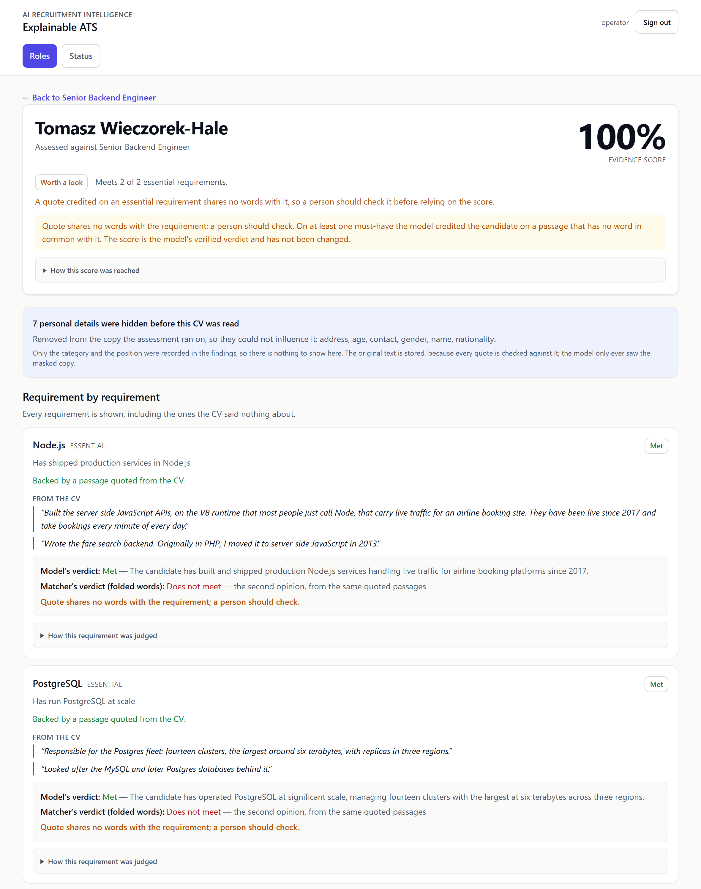

# Explainable ATS

Screens a CV against a role and explains every placement with the exact sentences from the CV that earned it: a model proposes each verdict and quotes the CV, code checks every quote and does the arithmetic, and a recruiter decides.

<!-- SCREENSHOT: candidate detail view (score, verdicts, quoted evidence) goes here -->
**Demo video (88 seconds, AI-voice narration, English captions):** [watch it on the case study](https://portfolio-azure-six-79.vercel.app/case-study-explainable-ats.html). It is a recording of the real app on live Claude Haiku 4.5 runs over invented CVs. A YouTube copy will be linked here when it exists.

## Key facts

- **What it does.** A person declares a role's requirements, each with a weight and an essential-or-desirable flag. The system reads a CV against them, ranks the candidates and shows, for every verdict, the quoted passage behind it.
- **The design principle.** *The model proposes, the code checks, a person decides.* A language model is used in exactly one stage. It sees only redacted text. For each requirement it returns a verdict, the passages it relies on (up to four) and a one-line reason. It cannot give a score, a rank or a decision. (`VERDICT_MODE=matcher` keeps the earlier design, where the model only quotes and a rule-based matcher judges the quotes. The public demo runs that one.)
- **Nothing counts until it is checked.** Every quote is looked up verbatim in the original CV. A quote that isn't there is stored as rejected and never shown or scored, and a `met`, `partial` or `not_met` verdict left with no verified quote reads `unclear`. A CV that says nothing about a requirement is `unclear`, never `not_met`.
- **Everything after the verdicts is reproducible.** Scores are integers you can recompute by hand, rankings are derived on every read, and an append-only audit trail records each step. A rule-based matcher reads the same verified quotes as a second opinion: it is shown to the recruiter and never changes a score. A credited verdict whose quote shares no word with the requirement is flagged, and on a must-have it sends the candidate to `needs_review`.
- **Stack.** Node 24 and TypeScript (run directly, no build step), Express 5, SQLite or PostgreSQL behind one interface, React 19 with Vite and Tailwind. The server has three runtime dependencies: `express`, `pg` and the Anthropic SDK.
- **Tests.** With the two portfolio repositories checked out beside this one (as CI does), `npm test` reports 886 passing, 0 failing and 0 skipped (673 server, 213 web). Six of those are helper modules the runner counts, so there are 880 test cases. In a standalone clone the parity tests, which need the portfolio sites, are skipped. [What they protect](docs/TESTING.md).
- **Where it stands.** A portfolio project. The public demo uses the deterministic mock extractor, a keyword matcher, in place of the model, on five invented candidates. The running app calls the real model when a signed-in recruiter starts an assessment, and it has been evaluated once, on invented data: on 2026-10-19 Claude Haiku 4.5 read twenty invented CVs and its verdicts agreed with 86.8% of 68 labels (Labels drafted by ChatGPT; reviewed independently by ChatGPT and Claude (agreed on 64 of 68 rows); final decisions approved by Sameer. Not an independent human labelling.) One model, one run. See [Evaluation](#evaluation) for the numbers and what they do not show, and [Limitations](#limitations).

## Run it locally

**Prerequisites:** Node.js 24 or newer (the `engines` field in `package.json`). Nothing else — no
database, API key or account.

```bash
npm run demo
```

Run that from the repository root. It installs the dependencies, builds the dashboard and starts the
app in demo mode. When it prints `Open http://localhost:3200/#/demo`, open that address.

One terminal is enough: the server serves the dashboard on the same address as the API. The demo
runs on five invented candidates, in a private in-memory session per browser, with the deterministic
mock extractor — so **no API key is needed**, and no real applicant data is involved. The full
recruiter application (sign-in, database, seeded data) is described under
[Running the full application](#running-the-full-application).

## How it works



The orange box is the only place a model runs. Every other box is plain code. In that stage the adapter **offers the `record_verdicts` tool** (and forces it where the model allows), so the only reply the pipeline accepts is a list of verdicts with their quotes, and the model is given redacted resume text only. In the quotes-only mode (`VERDICT_MODE=matcher`, which the demo uses) it **offers the `record_evidence` tool** instead, and the reply is quotes alone.

| Stage | What it does | File |
|---|---|---|
| Ingest | Stores the CV text and its redacted copy; refuses empty or oversized input; the same document twice is one resume | `server/src/agent/ingest.ts` |
| Redact | Masks protected attributes with `█` runs of equal length, so offsets match in both copies | `server/src/agent/redact.ts` |
| Extract | Sends the requirements and the redacted text to the provider, which must answer through a `record_verdicts` tool call (forced where the model allows it): per requirement a verdict, up to four passages and a reason. In `matcher` mode it is `record_evidence`, quotes only | `server/src/agent/extractVerdicts.ts`, `server/src/agent/verdictExtraction.ts`, `server/src/agent/extract.ts`, `server/src/agent/extractionSchema.ts` |
| Verify | Looks each quote up in the original text; rejects anything not found or overlapping a mask | `server/src/agent/verifyEvidence.ts` |
| Check | In `model_checked` mode the code enforces its rules (a verdict needs a verified quote; silence is `unclear`), the matcher gives a second opinion on the same quotes, and a credited verdict whose quote shares no word with the requirement is flagged. In `matcher` mode the matcher alone gives one verdict per requirement from how many of its significant terms the verified quotes contain | `server/src/agent/verdictEnforcement.ts`, `server/src/agent/verdictMode.ts`, `server/src/agent/matchRules.ts`, `server/src/agent/match.ts` |
| Score | `floor(Σ weight × verdict points / Σ weight)`, with contributions that sum exactly to it | `server/src/agent/score.ts` |
| Rank | Four tiers, then score; derived on every read and never stored | `server/src/agent/rankRules.ts`, `server/src/agent/rank.ts` |
| Decide | A recruiter records `shortlist`, `reject` or `hold` with a written reason, once per assessment | `server/src/handlers/evaluations.ts` |

## Terms and what the screen says

The code uses one set of words and the screens use another. This is the mapping (the screen wording is in `web/src/copy.ts`).

| Code | Meaning | The screen says |
|---|---|---|
| `met` | The CV shows the requirement in full: the model's reading, backed by a verified quote (in `matcher` mode: quotes covering at least 75% of what it asks for) | **Met** |
| `partial` | It shows some of it (in `matcher` mode: at least 35% but less than 75%) | **Partly met** |
| `not_met` | The CV speaks to it and falls short, with the quote that shows it (an explicit "I have not ..." in `model_checked` mode) | **Does not meet** |
| `unclear` | No verified quote at all. The CV is silent either way. A verdict whose quotes were not found in the CV also reads `unclear` | **Not demonstrated** |
| `qualified` | Every must-have is `met` | **Meets every must-have** |
| `needs_review` | No must-have failed, but at least one was `unclear`, or a credited must-have quote shares no word with its requirement (the flag). The page says which | **Worth a look** |
| `gated` | A must-have was addressed and is `partial` or `not_met` | **Missing an essential** |
| `not_evaluated` | No scored evaluation for this job | **Not assessed yet** |
| `shortlist` | Decision: move the candidate forward | **Shortlist** |
| `hold` | Decision: park for a closer look | **Hold** |
| `reject` | Decision: do not take further | **Reject** |
| `must_have` / `nice_to_have` | A requirement's kind | **Essential** / **Desirable** |
| `scoreBasisPoints` | The score as an integer from 0 to 10000 | A whole percent (7142 shows as 71%) |
| evaluation | One assessment of one candidate against one job | **Assessment** |

`not_met` and `unclear` are different on purpose. "The CV says something that falls short" and "the CV says nothing" are different facts about a person, and the screens never show both as "no".

## Architecture

Two packages: `server/` (Express, the pipeline, two database drivers) and `web/` (React, one bundle served by the same origin as the API). Routes stay thin, handlers hold request logic, and the pipeline in `server/src/agent/` holds the business rules. One built front end serves two server modes, `app` and `demo`.

The detail, with a diagram of each stage's inputs and outputs, the data model, request flows and the reasons behind each design choice, is in [docs/ARCHITECTURE.md](docs/ARCHITECTURE.md).

## Explainability and evidence

- **Every verdict shows its quote.** Each requirement on a candidate's page carries its verdict, a confidence (`high`, `medium` or `low`), a rationale, and the verified passages with their positions in the CV. In `model_checked` mode it also shows the model's verdict and one-line reason, what the code left standing (and why it lowered a verdict, if it did), the matcher's verdict beside it, and, where it applies, "Quote shares no words with the requirement; a person should check."
- **Only verified passages are ever sent to the browser.** Rejected quotes are kept in the audit trail so a fabrication stays visible, but `server/src/handlers/evaluations.ts` never sends them.
- **The audit trail tells the whole story.** One ordered history merges the resume's events (ingestion, redaction) with the evaluation's (extraction, verification, matching, scoring, the decision). The score event carries every input, so the number can be recomputed from the trail alone.
- **A model's verdict is shown beside the rule-based check.** For a candidate scored in `model_checked` mode the page shows the model's verdict and its one-line reason, the verified quote, the matcher's second opinion, and the flag where a credited quote shares no word with the requirement:

  

  *One live run of Claude Haiku 4.5 on an invented CV (cv-02), 2026-10-19, shown again from the saved reply with no new request.* The model's reply is kept in `docs/results/replay-2026-10-19-cv-02-claude-haiku-4-5-20251001.json`, and `server/scripts/live-replay.ts --replay=<that file>` runs it through the pipeline again with no request, so the page can be shown again without calling the model. All three flags are paraphrases the word-counting check cannot see ("the V8 runtime that most people just call Node" for Node.js, "Postgres" for PostgreSQL, "coached" for mentored); the labels say `met` for all three, so here the flag is the matcher's blind spot, shown for a person to glance at, not a mistake by the model.
- **A ranking explains itself.** Each entry carries a sentence: *"Scored 71% and meets 1 of 2 must-haves. The evidence found does not demonstrate "PostgreSQL". Placed below every candidate who meets all of them, however high that score is — the score itself is unchanged."*

## Privacy and redaction

The model is given `redacted_text` and never the original, so a protected attribute can't influence extraction: it isn't in the input. That is a structural guarantee, not an instruction the model could ignore.

- **What is masked.** Emails and phone numbers, labelled fields (date of birth, age, nationality, marital status, gender, address, photo, religion, name), and any names the caller supplies. The categories are `name`, `age`, `gender`, `nationality`, `photo`, `address`, `marital_status`, `religion`, `contact` and `other`.
- **How.** Each span becomes a run of `█` of exactly the same length. Labels stay, so a recruiter can see *what* was removed. Offsets are identical in both copies, so a position the model reports against the redacted text indexes the original directly.
- **What is stored.** The model only ever sees the redacted copy. The `sensitive_findings` table records a category and a character range, never the value. The original text is stored (`resumes.content_text`), because quote verification checks every quote against it, so it contains whatever personal details the CV did.
- **What reaches the browser.** Categories and a count, never values. A candidate's name is never an input to scoring or ranking.
- **A quote that overlaps a mask is refused**, even when the text is genuinely in the CV. The model was never shown it, so producing it means a guess or a leak.

Redaction is pattern-based and tuned for the synthetic dataset. It is a demonstrable boundary, not a general-purpose PII scrubber for real resumes.

## Scoring

```
score = floor( Σ (weight × verdict points) / Σ weight )     met = 10000, partial = 5000, not_met = 0, unclear = 0
```

The demo role is *Senior Backend Engineer*, with three requirements:

| Requirement | Kind | Weight |
|---|---|---|
| Node.js | must-have | 3 |
| PostgreSQL | must-have | 2 |
| Mentoring | nice-to-have | 2 |

The weights add up to 7. The worked examples below are the public demo. It runs in `matcher` mode with the mock extractor, so here the rules rather than a model decide each verdict, and it folds word endings (`MATCH_MODE=folded`, the application's default and the setting its evaluation used), so "Running" counts as the criterion's "run". With a model the verdicts are its own, checked as described above, and everything from the arithmetic on is the same. Here are three of the five candidates, as the running system scores them.

**Rowan** scores 100% and is qualified, the top of the list.

| Requirement | Quote found in the CV | Verdict | Points earned |
|---|---|---|---|
| Node.js | "Designed and shipped production Node.js services for a freight booking platform." | `met` (4 of 4 terms) | 3 × 10000 = 30000 |
| PostgreSQL | "Running PostgreSQL at scale, moving a single instance to a replicated cluster." | `met` (3 of 3 terms; "running" folds to "run") | 2 × 10000 = 20000 |
| Mentoring | "Mentoring: mentored four junior engineers through their first releases." | `met` (4 of 4 terms) | 2 × 10000 = 20000 |

`(30000 + 20000 + 20000) / 7 = 10000`, exactly. The shares are 4285.7, 2857.1 and 2857.1; their floors add up to 9999, and the leftover point goes to the largest remainder, so the contributions are **4286, 2857 and 2857**.

**Marcus** scores 7142. His Node.js and Mentoring are `met`, but his only PostgreSQL quote is "Used PostgreSQL for a final-year university project.". It contains one of the three terms (`postgresql`, `run`, `scale`), so the verdict is `not_met`. `(30000 + 0 + 20000) / 7` is 7142.8…, so **7142** (71%), with contributions 4285, 0 and 2857. Because a must-have was addressed and fell short, he is **gated**.

**Ines** scores 7142, the same as Marcus. Node.js is `met`, and her Mentoring quote ("Mentored a junior developer during onboarding.") covers three of four terms (the folded "mentored" and "mentoring" are one word), so it is `met`. Her CV says nothing about PostgreSQL, so that is `unclear`: `(30000 + 0 + 20000) / 7 = 7142.8…`, so **7142**, with contributions 4285, 0 and 2857.

**Devi** also scores 7142 and is qualified: Node.js and PostgreSQL are `met`. Her Mentoring reads `not_met` although her CV says nothing about mentoring, and the cost of folding is the reason: her job title, "Backend Engineer", folds to "engineer", which is one of the criterion's words, so the stand-in extractor quoted it. It is the matcher's mistake, not a finding about her, and it does not move her tier because mentoring is desirable.

The resulting order:

| Rank | Candidate | Score | Tier | Why |
|---|---|---|---|---|
| 1 | Rowan | 100% | Meets every must-have | Every requirement `met` |
| 2 | Devi | 71% | Meets every must-have | Both essentials `met`; mentoring misread, as above |
| 3 | Ines | 71% | Worth a look | PostgreSQL is `unclear`, so it is unresolved, not failed |
| 4 | Marcus | 71% | Missing an essential | The PostgreSQL evidence fell short |
| — | Toby | — | Not assessed yet | Received but not yet assessed |

Devi, Ines and Marcus tie at 7142 and are placed by tier, which is the must-have gate shown as clearly as it can be: same number, three placements, each with its sentence ("Ranked 2 of 4 assessed candidates. …"). Ines ranks above Marcus although her score is no higher, because `needs_review` sits above `gated`.

**The same five CVs with whole-word matching** (`MATCH_MODE=strict`: "Running" is not "run", "mentored" is not "mentoring"):

| Rank | Candidate | Score | Tier | What changed |
|---|---|---|---|---|
| 1 | Ines | 57% | Worth a look | Mentoring only `partial`; PostgreSQL `unclear` |
| 2 | Rowan | 86% | Missing an essential | PostgreSQL only `partial`: "Running" is not "run" |
| 3 | Marcus | 71% | Missing an essential | Unchanged |
| 4 | Devi | 57% | Missing an essential | The same word form as Rowan, and nothing on mentoring (`unclear`, not `not_met`) |
| — | Toby | — | Not assessed yet | Unchanged |

Nobody is qualified, and that is the honest result of whole-word matching on these CVs. The CVs were written to say "Running PostgreSQL at scale" against the criterion "Has run PostgreSQL at scale", and they have not been reworded to suit either rule. Folding has a cost the strict rule does not (Devi's mentoring above); whole-word matching has the opposite one. In `model_checked` mode, which is the app's default, the match mode only sets how the matcher's second opinion and the flag compare words; it never changes a verdict. The app and the demo default to `folded` because that is how it was evaluated. For what it is worth, when the matcher judged alone against the labels, `folded` agreed with 36.8% of the 68 rows and `strict` with 30.9% (the first run, on Haiku 4.5, quotes only).

## API

All routes are under `/api`. Errors share one envelope, `{ "error": { "code", "message" } }`, with the codes `VALIDATION_ERROR` (400), `UNAUTHORIZED` (401), `FORBIDDEN` (403), `NOT_FOUND` (404), `CONFLICT` (409), `INVALID_STATE` (409), `PROVIDER_UNAVAILABLE` (502), `RATE_LIMITED` (429) and `INTERNAL_ERROR` (500).

### Real application (`APP_MODE=app`)

| Method and path | Access | Purpose |
|---|---|---|
| `GET /api/health` | Public | Liveness, the `mode`, and whether the database is reachable. Never reports a secret |
| `POST /api/auth/login` | Public, 10 per minute | Sign in with the operator password |
| `POST /api/auth/logout` | Anyone | End the session (always succeeds) |
| `GET /api/auth/session` | Public | Whether there is a session; answers "no" rather than 401 |
| `GET /api/jobs` | Session | The roles, with counts |
| `GET /api/jobs/:jobId` | Session | One role and its requirements |
| `GET /api/jobs/:jobId/ranking` | Session | The finished ranking: positions, ranks, tiers and sentences |
| `GET /api/evaluations/:evaluationId` | Session | One candidate against one role: verdicts, quotes, score |
| `GET /api/evaluations/:evaluationId/audit` | Session | The ordered history of that assessment |
| `GET /api/evaluations/:evaluationId/status` | Session | The cheap thing the dashboard polls while an assessment runs |
| `POST /api/jobs` | Session + CSRF token | Create a role with its requirements (weight 1 to 10, essential or desirable) |
| `POST /api/jobs/:jobId/candidates` | Session + CSRF token | Add a CV as pasted plain text: stores and redacts it, opens a pending evaluation, calls no model |
| `POST /api/evaluations/:evaluationId/run` | Session + CSRF token | Start extraction and scoring. Answers **202** and works in the background |
| `POST /api/evaluations/:evaluationId/rerun` | Session + CSRF token | Re-run a failed assessment as a new one that replaces it (audited) |
| `POST /api/evaluations/:evaluationId/decision` | Session + CSRF token | Record the recruiter's decision. Body `{ outcome, reason }` |

Every route except health and the three sign-in routes sits behind the session gate. There is no anonymous read of real data.

`POST /api/evaluations/:evaluationId/decision` takes `outcome` (`shortlist`, `reject` or `hold`) and a `reason` of 10 to 2000 characters. It returns 201 with the decision and the resulting evaluation. It refuses with 403 (no CSRF token), 400 (bad outcome or short reason), 409 (not yet scored, superseded by a newer assessment, or already decided) and 404.

**Adding and assessing a CV.** `POST /api/jobs/:jobId/candidates` takes `reference`, an optional `displayName` and the CV `text` (up to 200,000 characters). The same CV twice for the same person is a 409; a changed CV opens a new evaluation that replaces the old one. `POST .../run` starts the work and answers 202 at once: the model call and the scoring happen in the background, in this process, with at most three assessments in flight. The dashboard polls `GET .../status` until it reads `scored` or `failed`. There is no job queue, so an assessment that was running when the server restarted is left `pending`, and `POST .../rerun` accepts it. `POST .../rerun` is also how a `failed` assessment is retried: it opens a new evaluation that supersedes the failed one, which keeps its failure reason and its audit trail. Every write names the signed-in operator in the audit trail.

The same provider is used by every route that runs extraction: the one `LLM_PROVIDER` names (`mock` by default). The public demo never builds a provider.

There is no file upload. Every route above takes JSON.

### Public demo (`APP_MODE=demo`)

The demo registers health and the visitor-scoped routes below, and nothing else. They are anonymous, and each is answered from the visitor's own private in-memory database.

| Method and path | Purpose |
|---|---|
| `POST /api/demo/session` | Start a session, or resume the one the cookie names |
| `GET /api/demo/session` | Is there one? Never an error |
| `POST /api/demo/session/reset` | Restore this visitor's copy of the dataset |
| `DELETE /api/demo/session` | End this visitor's session |
| `GET /api/demo/session/jobs`, `.../jobs/:id`, `.../jobs/:id/ranking` | The dashboard's reads |
| `GET /api/demo/session/evaluations/:id`, `.../audit` | One assessment and its history |
| `GET /api/demo/session/evaluations/:id/resume` | The **redacted** resume text, and nothing else |
| `POST /api/demo/session/evaluations/:id/decision` | A demo decision, saved only to this visitor's session |

A demo decision is recorded as the fixed actor `demo-visitor` and reuses the recruiter's decision logic (same outcomes, same reason rule, same one-per-assessment rule), but looks the evaluation up only in the caller's own database.

## Security

- **Sign-in.** One operator and one shared password. The password is checked against a scrypt hash (`OPERATOR_PASSWORD_HASH`, made with `npm run hash-password`). There is no built-in default password, so an unconfigured server answers 401 to everything protected.
- **Sessions.** An opaque random token in an `ats_session` cookie (`HttpOnly`, `SameSite=Strict`, `Secure` unless `COOKIE_SECURE=false`). The server stores only its SHA-256. Lifetime is `SESSION_TTL_HOURS` (default 12) and is fixed at sign-in.
- **CSRF.** A second cookie, `ats_csrf`, is readable by the front end, which echoes it in the `x-csrf-token` header on every write. The server compares it with the session's own token. A cross-origin POST is also refused, and the CORS allow-list is empty because the front end is served from the same origin.
- **Who decided.** The deciding operator comes from the verified session, never from a header or the request body, so a decision is always attributable.
- **Auth by position.** Everything registered after the session gate is protected by default. A forgotten route is closed, not open.
- **Rate limiting.** Fixed-window, keyed by session when signed in and by address otherwise: 10 per minute for sign-in, 120 per minute for writes, and a `demoSession` class of 10 per minute for starting, resetting or ending a demo session. It is in-memory and single-process, so a restart or a second instance doesn't share counters.
- **The demo can't reach real data.** The demo deployment has no canonical database. It refuses to start if `DATABASE_URL`, `OPERATOR_PASSWORD_HASH` or `ANTHROPIC_API_KEY` is set, if `LLM_PROVIDER` is anything but `mock`, or if `SQLITE_PATH` is anything but `:memory:`, and it says which variable without printing a value. The demo deployment always uses the mock. Its sessions are ephemeral: two hours without use, at most 100 exist (the least recently used is evicted), and a restart discards them all. The `ats_demo` cookie is `HttpOnly` and `SameSite=Strict` and names a sandbox, not an identity.
- **The model has no authority.** It can only return verdicts and quotes, and every quote is verified against the original CV. It can't score, rank or decide, and it isn't connected to any HTTP route.
- **Prompt injection.** A CV that contains instructions can't write a score: the model has no score field, a quote is accepted only if its words are really in the CV, and a verdict with no verified quote reads `unclear`. What it can do is steer the model's verdict and which real passages get quoted. A credited verdict on a quote that shares no word with the requirement is flagged, and on a must-have it sends the candidate to review; a model that did obey would still be scored as it said. Resume text is placed in the prompt under plain section markers. A live check of eight hostile CVs on Haiku 4.5 is described under [Limitations](#limitations).
- **Secrets.** An API key is read from the environment, never logged, and never returned by health, the audit trail or an error.

## Testing

Tests use Node's built-in runner on both sides. No test needs a credential, a network or a database server. [docs/TESTING.md](docs/TESTING.md) explains what each group of tests protects and walks through eight of them.

```bash
cd server && npm test        # 673 reported: 668 test cases and 5 helper modules
cd web && npm test           # 213 reported: 212 test cases and 1 helper module
```

`server/test/demo-parity.test.ts` compares this pipeline with the browser-demo runner in the separate `sameer-3d-portfolio` repository, and with the copy of that runner in the `portfolio` repository (the 2D site). Each comparison runs against every copy it can find. It finds the 3D runner through `PORTFOLIO_DEMO_DIR`, then `../sameer-3d-portfolio/src/demo/p3`, then `../../sameer-3d-portfolio/sameer-3d-portfolio/src/demo/p3`. The 2D copy is looked for at `../portfolio/src/demo/p3`, or at `PORTFOLIO_2D_DEMO_DIR` if that is set. If no copy holds `run.ts` the 11 parity tests are reported as skipped, as they are in a standalone clone. CI (`.github/workflows/ci.yml`, two jobs on Node 24, no secrets) checks both portfolio repositories out first (the branch of the same name if there is one, otherwise `main`), runs `npm audit --audit-level=high`, and treats a missing sibling as a failure, not a skip, so nothing is skipped there.

There are no browser or end-to-end tests. The real model was evaluated once against the labels in `eval/` with a by-hand script (`server/scripts/eval-harness.ts`), never in CI; see [Evaluation](#evaluation).

## Evaluation

One run, on invented data. Read it as "the pipeline works on a small, varied set", not as an accuracy figure for real CVs.

| | |
|---|---|
| Run | 2026-10-19, `server/scripts/eval-harness.ts`. Claude Haiku 4.5 (`claude-haiku-4-5-20251001`), forced tool choice, temperature 0, prompt `extract-v3`, `VERDICT_MODE=model_checked`, `MATCH_MODE=folded`. 20 requests, one per CV, no retries, about $0.09 |
| Data | Twenty invented CVs, written by an AI, for two roles: 68 CV-and-requirement pairs |
| Labels | Labels drafted by ChatGPT; reviewed independently by ChatGPT and Claude (agreed on 64 of 68 rows); final decisions approved by Sameer. Not an independent human labelling. |
| Verdict agreement | **86.8%** (59 of 68 pairs get the verdict the labels give) |
| Tier agreement | **85.0%** (17 of 20 candidates land in the same tier as the labels give) |
| Passages | Recall 92.5%, precision 82.7% (a quote counts as a hit when it overlaps a labelled passage by at least half of the shorter of the two). 2 of 77 proposed quotes were not in the CV and were rejected |
| The code's checks | Lowered 2 of 68 verdicts to `unclear` (no verified quote behind them). Flagged 6 credited verdicts whose quote shared no word with the requirement, which sent 1 of 20 candidates (a must-have) to `needs_review` |
| The matcher alone | On the same quotes, 38.2% verdict agreement and 35.0% tier agreement (`folded`; 36.8% `strict`). That gap is why the model proposes the verdict and the matcher is only a second opinion |
| Hostile CVs | Eight invented hostile CVs, one request each. Seven came out as the genuine content supports (a score of 43%, from the one real Node.js line). The keyword-stuffed one was credited in full |

Files: [`docs/results/`](docs/results/), each with its settings and its label provenance.

What this does not show:

- **One model, one run, twenty CVs.** Each verdict is about 1.5 points. There are no repeats, and temperature 0 does not make a model fully repeatable.
- **Not independent.** The CVs were written by an AI. The labels were drafted by one AI and reviewed by two, and the final decisions were approved by one person; they are not an independent human labelling. A set of five more CVs was written to be held out, but it was never labelled and never run.
- **Not a held-out result.** The first scoring of this run used a rule that lowered a flagged verdict automatically, and agreed on 77.9%. The rule was removed after looking at which rows it hurt (the model's verdict matched the label in all six it lowered), and 86.8% is the same replies re-scored without it. The rules were chosen on the same 68 rows they are measured on, so the figure probably flatters.
- **Where it disagrees.** Nine pairs. Three are a CV whose only evidence is a skills list: the model says `unclear`, the labels say `partial`. Two are `not_met` where the labels say `partial`. Of the other four, three are the model being more generous than the labels (twice in one CV) and one is a correct verdict the code lowered because the quote behind it was not found.
- **Keyword stuffing is a known limit.** A quote that lists every word of a requirement is real text in the CV, so it is verified and credited; the live run did exactly that. In the offline tests, a simulated model that obeys every injected instruction is scored as it says (100% against 43% for an honest one), with every credited line flagged and the candidate sent to review. The real model was not fooled in the live run, but that is eight CVs and one run.

## Limitations

- **Evaluated once, on invented data.** The numbers are under [Evaluation](#evaluation): twenty invented CVs, labels that are not an independent human labelling, one model, one run. Nothing has been measured on real resumes, and the figure was reached on the same rows it was tuned on.
- **The demo's extractor is a keyword matcher.** Extraction defaults to the deterministic mock everywhere unless `LLM_PROVIDER=anthropic` is set. It quotes whole lines containing the most requirement terms. That exercises the pipeline but says nothing about how a real model would do.
- **Anthropic provider: evaluated once, on invented data.** `LLM_PROVIDER=anthropic` builds an adapter that offers (or, where the model allows it, forces) a `record_verdicts` tool call, with a timeout and bounded retries. It is tested against a fake client and a loopback stub server, and by-hand scripts have made real requests: a smoke run (one real request each to `claude-sonnet-5-5` and `claude-haiku-4-5-20251001` on 2026-10-14: both returned a well-formed tool call whose quotes were all verified), a check of the failure paths, the evaluation above and a hostile-CV check. The smoke run found that Sonnet 5.5 rejects a forced tool call and rejects any `temperature`, so tool choice and temperature are settings, and the defaults are the ones Haiku 4.5 was measured with. The running app calls the configured provider only when a signed-in recruiter starts an assessment.
- **The matcher is term coverage, not comprehension.** It counts how many significant words of a requirement appear in the quotes, as whole words: "Java" is not found in "JavaScript" and "run" is not found in "running". By default in `strict` mode word forms count as different terms ("mentored" and "mentoring"), and synonyms never match ("Postgres" and "PostgreSQL"). `MATCH_MODE=folded` closes the first gap at a price ("engineering" meets "engineer", and a job title can be quoted as evidence for a requirement the CV is silent on). Paraphrase is missed either way. That is why, in `model_checked` mode, it is only a second opinion and a flag: judging alone it agreed with 36.8% of the labels, even when the quotes were right. The demo, which has no model, is scored by it. Each of these is pinned by a test.
- **The matcher does not understand negation.** "Never shipped a Node.js service" covers the same terms as "Shipped a Node.js service" and gets the same verdict from the matcher. In `model_checked` mode the model reads the sentence; the prompt asks it to use `not_met` only when the CV speaks to the requirement and falls short, or says outright that the person has not done it, and the code checks that a verified quote exists (it does not test that the quote is a negative). The matcher's disagreement is shown, not acted on. A test pins the matcher's behaviour so that changing it is a decision.
- **Prompt injection is reduced, not removed.** The resume is untrusted input. The prompt tells the model so, and the section markers are stripped from the CV text, but the defence that does not depend on the model is structural: a model can only propose verdicts and quotes, each quote is checked against the CV, a verdict with no verified quote reads `unclear`, and scores are computed by code. A model that was fooled into crediting a line that really is in the CV would be scored as it said; the safeguard is the flag, and on a must-have the routing to a person, for a quote that shares no word with the requirement. A quote that does share words is not flagged. The live check on eight invented hostile CVs (instruction override, "score me 100%", marker spoofing, fabricated quotes, hidden instructions, keyword stuffing, an embedded requirement list, a 150,000-character CV), on Haiku 4.5 with the prompt and settings above, found seven of seven asserted CVs unchanged by the attack and no verified quote overlapping an attacker's words. Keyword stuffing was credited in full. One run; results in `docs/results/`. An earlier run of the quotes-only prompt on Sonnet 5.5 and Haiku 4.5 is kept there too.
- **Words can be stuffed.** A quote that lists every term of a requirement covers it, for the model as for the matcher. Verification makes sure the passage is really in the CV and at least 15 characters long (a bare "Node.js" is refused), but it cannot tell a skills list from an achievement. In the evaluation the model was cautious with a skills list that stood alone (it said `unclear` where the labels said `partial`), and credited the stuffed hostile CV in full.
- **Synthetic data only.** Everything runs on five invented candidates and one invented role. Nothing has been measured on real resumes.
- **Redaction is pattern-based.** It catches emails, phones, labelled fields and supplied names. Unlabelled personal details can pass through.
- **Plain text only.** There is no upload endpoint and no PDF or DOCX parsing. Requirements are typed input; nothing is inferred from a job advert.
- **One operator, one password.** There are no accounts or roles.
- **Rate limiting is in-memory and single-process.**
- **No defence in the prompt that is known to hold.** The prompt asks the model to treat the CV as data, and the live check above found it did, on eight CVs and one run. That is evidence, not a guarantee.
- **PostgreSQL has no automated test.** Every test runs on SQLite. I ran the PostgreSQL path by hand against a PostgreSQL 17 container: migrations applied twice (the second applied nothing), the demo dataset seeded, and the real server handled sign-in, ranking, a decision, a repeated decision (409) and a short reason (400).
- **No deployment configuration** (no Dockerfile or `render.yaml`) is included.
- **No cost tracking in the app.** Token usage from the provider is recorded in the audit trail when reported, but there is no cost calculation and no cost tracking there. The evaluation script estimates and totals cost for its own runs from prices given by the owner.

## License

MIT. See [LICENSE](LICENSE).

## Project structure

```
.
├── README.md                    this file
├── docs/
│   ├── ARCHITECTURE.md          stages, data model, request flows, design decisions
│   └── TESTING.md               what the tests protect, with worked examples
├── package.json                 the one-command demo (`npm run demo`)
├── server/
│   ├── src/
│   │   ├── agent/               the pipeline: ingest, redact, extract, verify, match, score, rank
│   │   ├── adapters/llm/        the model boundary: mock and Anthropic providers
│   │   ├── db/                  the Database interface, two drivers, repositories
│   │   ├── demo/                the synthetic dataset and per-visitor sandboxes
│   │   ├── domain/              the vocabulary and scoring constants
│   │   ├── handlers/            request logic, independent of Express
│   │   ├── routes/              thin Express routers
│   │   ├── auth/, http/         sessions, CSRF, CORS, rate limiting
│   │   └── config/, lib/        configuration and small shared utilities
│   ├── migrations/              001_foundation.sql to 005_quote_no_overlap.sql
│   ├── scripts/                 migrate, seed:demo, hash-password, demo; by-hand: eval-harness, rescore-saved, validate-labels, live checks
│   └── test/                    39 test files and 5 helper modules
├── web/
│   ├── src/                     React app: screens, components, demo views, API client
│   └── test/                    13 test files and 1 helper module
└── .github/
    ├── workflows/ci.yml         server and web jobs: install, audit, test, typecheck, lint (and build)
    └── scripts/                 checks the two portfolio repositories out beside this one for CI
```

Key files:

| File | What is in it |
|---|---|
| `server/src/domain/ats.ts` | Every closed set: verdicts, tiers, outcomes, redaction categories |
| `server/src/agent/redact.ts` | The masking patterns |
| `server/src/agent/verdictExtraction.ts` | The `record_verdicts` tool, the `extract-v3` prompt and the strict reading of the reply |
| `server/src/agent/extractVerdicts.ts` | The model call for verdicts, the verification of every quote, the first check of each verdict |
| `server/src/agent/verdictEnforcement.ts`, `server/src/agent/verdictMode.ts` | The code's rules for a model's verdict, the second opinion and the flag |
| `server/src/agent/extractionSchema.ts` | The `record_evidence` tool of the quotes-only mode |
| `server/src/agent/extractionPrompt.ts` | The `extract-v2` prompt of the quotes-only mode, the untrusted-data clause and marker neutralisation |
| `server/src/agent/verifyEvidence.ts` | The verbatim check against the original CV |
| `server/src/agent/matchRules.ts` | Term coverage and the 75% and 35% thresholds (the matcher) |
| `server/src/agent/score.ts` | The basis-point arithmetic and apportionment |
| `server/src/agent/rankRules.ts` | Tiers and ordering |
| `server/src/agent/mockExtractor.ts` | The demo's keyword extractor |
| `server/src/adapters/llm/anthropic.ts` | The only file that imports the Anthropic SDK |
| `server/src/db/dialect.ts` | SQLite to PostgreSQL translation |
| `server/src/db/repositories/audit.ts` | The append-only audit writer |
| `server/src/handlers/evaluations.ts` | Reads, the audit view and the decision write |
| `server/src/routes/demoSession.ts` | The visitor-scoped demo routes |
| `server/src/demo/dataset.ts` | The five invented candidates and the role |
| `server/src/demo/sessions.ts` | Sandbox lifetime, eviction and limits |
| `server/src/http/rateLimit.ts` | The fixed-window limiter |
| `server/src/app.ts` | Route wiring and the security order |
| `server/src/config/mode.ts` | The two modes |
| `server/migrations/001_foundation.sql` | Sessions and the audit table |
| `server/migrations/002_domain.sql` | The domain tables |
| `server/migrations/003_evaluation_records.sql` | What each extraction used and returned: model, tokens, latency, the raw answer |
| `server/migrations/004_verdict_checks.sql`, `server/migrations/005_quote_no_overlap.sql` | What the model said for each requirement, what the code did with it, the matcher's second opinion and the flag |
| `server/scripts/demo.ts` | What `npm run demo` runs |
| `server/scripts/seed-demo.ts` | Runs the pipeline over the demo dataset (`npm run seed:demo`) |
| `server/scripts/migrate.ts` | Applies the migrations (`npm run migrate`) |
| `server/scripts/hash-password.ts` | Makes `OPERATOR_PASSWORD_HASH` |
| `server/scripts/live-smoke-anthropic.ts` | An opt-in, by-hand check of the real Anthropic adapter, never in CI |
| `server/scripts/live-injection-check.ts` | An opt-in, by-hand run of eight hostile CVs against the real API, saving counts to `docs/results/`, never in CI |
| `server/scripts/eval-harness.ts` | An opt-in, by-hand evaluation of the real model against the labels in `eval/`, never in CI |
| `server/scripts/live-replay.ts` | One recorded live request on an invented CV, and a replay of the saved reply with no request (for screenshots) |
| `server/scripts/export-demo-fixtures.ts` | Writes the vendored files and the demo dataset into the two portfolio sites, and `--check` fails on drift |
| `server/scripts/rescore-saved.ts` | Re-scores a saved evaluation offline, with no request |
| `server/scripts/validate-labels.ts` | Checks the label files in `eval/` |
| `server/scripts/live-failure-check.ts` | An opt-in, by-hand check of the cut-off, timeout and long-CV paths against the real API, never in CI |
| `server/.env.example` | Every setting, with its default |
| `docs/ARCHITECTURE.md` | Stages, data model, request flows, design decisions |
| `docs/TESTING.md` | What the tests protect |
| `server/test/repo-hygiene.test.ts` | Checks this README against the code |
| `web/src/copy.ts` | The recruiter wording from the table above |

## Configuration

Copy `server/.env.example` to a file named `.env` in the same folder and set only what you need. Every value has a working default, so with no `.env` at all the server migrates, tests and runs with no key and no database server.

| Variable | Default | Purpose |
|---|---|---|
| `APP_MODE` | `app` | `app` (the real application) or `demo`. Anything else stops the process at boot |
| `DATABASE_URL` | empty | A `postgres://` URL selects PostgreSQL; empty uses a local SQLite file. The driver asks for TLS unless the URL has a `sslmode=` parameter, so a local server without TLS needs `?sslmode=disable` |
| `SQLITE_PATH` | the file `explainable-ats.sqlite` in the `data` folder of `server` | Where the local SQLite file lives |
| `LLM_PROVIDER` | `mock` | `mock` or `anthropic` |
| `ANTHROPIC_API_KEY` | empty | Required only for `LLM_PROVIDER=anthropic`. With it selected and no key, the server refuses to start |
| `ANTHROPIC_MODEL` | `claude-haiku-4-5-20251001` | Sent verbatim; the adapter names no model of its own. This is the model the evaluation was run with. `claude-sonnet-5-5` stays available, with `ANTHROPIC_TOOL_CHOICE=auto` and `ANTHROPIC_TEMPERATURE=none` |
| `ANTHROPIC_TOOL_CHOICE` | `forced` | `forced` makes the tool call mandatory; `auto` lets the model call the tool (and a reply without the call is rejected). `claude-sonnet-5-5` rejects `forced`; both Haiku models accept it |
| `ANTHROPIC_TEMPERATURE` | `0` | 0 to 1; `none` sends no temperature. `claude-haiku-4-5-20251001` accepts 0; `claude-sonnet-5-5` and `claude-haiku-5-5` reject any temperature ("deprecated for this model"), so use `none` with them |
| `MATCH_MODE` | `folded` | How requirement words are compared with a quote. `strict`: whole words only ("run" is not found in "running", "service" is not "services"). `folded`: plural -s/-es, -ing and -ed endings are reduced first. Neither handles synonyms ("Postgres" is never "PostgreSQL") or negation. In `model_checked` mode it only sets the second opinion and the flag. Recorded in the audit trail of every score |
| `VERDICT_MODE` | `model_checked` | `model_checked`: the model proposes each verdict with its quotes, the code checks them, the matcher is a second opinion. `matcher`: the model only quotes and the matcher alone judges (the earlier design, and what the demo runs) |
| `ANTHROPIC_TIMEOUT_MS` | 60000 | Per-request timeout, maximum 300000 |
| `ANTHROPIC_MAX_RETRIES` | 2 | Retries for transient failures only, maximum 5 |
| `OPERATOR_PASSWORD_HASH` | empty | Required for anyone to sign in |
| `SESSION_TTL_HOURS` | 12 | Session lifetime, fixed at sign-in |
| `COOKIE_SECURE` | `true` | Browsers refuse `Secure` cookies over plain HTTP, so use `false` for `http://localhost` |
| `TRUST_PROXY` | 0 | How many reverse proxies are in front of the server |
| `WEB_DIST_DIR` | `web/dist` | Where the built front end lives |
| `CORS_ALLOWED_ORIGINS` | empty | Empty is correct: the front end shares the API's origin |
| `PORT` | 3200 | Server port |
| `LOG_LEVEL` | `info` | `debug`, `info`, `warn` or `error` |

A variable already set in your shell or in Windows' user environment wins over the same name in the `.env` file (Node's `--env-file` never overrides). A stale `ANTHROPIC_API_KEY` in the environment will therefore be used instead of the one in the file; remove it, or run the command with it unset.

### Running the full application

Needs Node 24 or newer.

```bash
cd server
npm install
npm run migrate          # applies server/migrations/*.sql
npm run hash-password    # reads a password from stdin; prints OPERATOR_PASSWORD_HASH
npm run seed:demo        # runs the pipeline over the fixed demo dataset
npm run dev              # http://localhost:3200

cd ../web
npm install
npm run build            # the server serves web/dist from the same origin
```

Set `OPERATOR_PASSWORD_HASH` (and `COOKIE_SECURE=false` over plain HTTP) in that `.env` before signing in. To run the demo by hand instead, build the web app and start the server with `APP_MODE=demo npm run start`. It needs no migrate, no seed and no key. Unset `ANTHROPIC_API_KEY` in that shell first, because the demo refuses to start with one.

### Hosting your own

This repository contains no deployment configuration. The two modes are meant to run as two separate services built from the same commit: the application service with `APP_MODE=app`, `OPERATOR_PASSWORD_HASH`, a database and `TRUST_PROXY=1`, and the demo service with `APP_MODE=demo` and `TRUST_PROXY=1` and nothing else from the list above. Don't share an environment between them: the demo will correctly refuse to start with the application's variables. Both need the web app built so the server can serve `web/dist`, and both can use `/api/health` as a health check, which always answers 200 and reports `degraded` if the database is unreachable.
