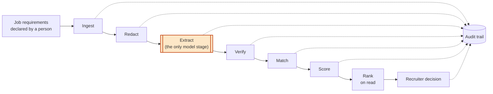
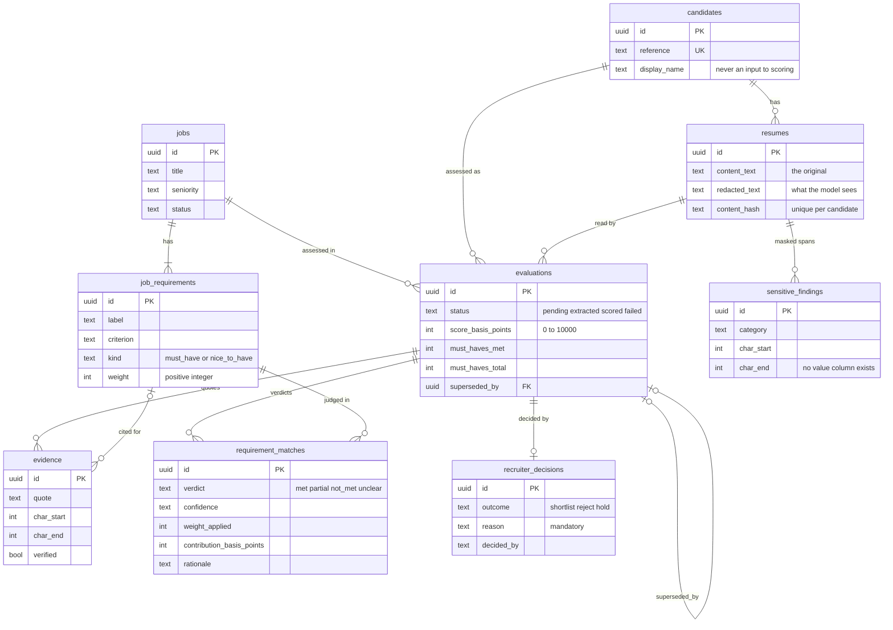
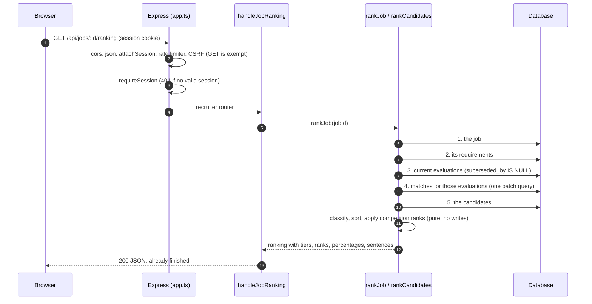
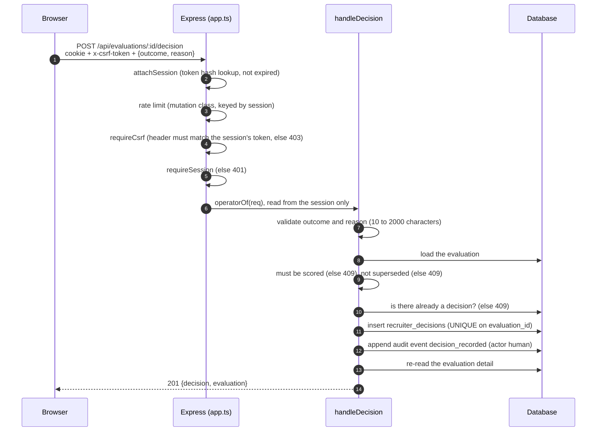

# Architecture

This document explains how Explainable ATS is built, stage by stage, and why it is built that way. The README gives the overview; this is the detail behind it.

The one idea everything follows from: **the model quotes, deterministic code judges.** A language model is used in exactly one stage, extraction, to find passages in a CV. Every stage after it is ordinary code that anyone can re-run by hand.

## Contents

1. [Components](#1-components)
2. [The pipeline, stage by stage](#2-the-pipeline-stage-by-stage)
3. [Data model](#3-data-model)
4. [Request flows](#4-request-flows)
5. [Database drivers](#5-database-drivers)
6. [LLM providers and failure](#6-llm-providers-and-failure)
7. [Two modes, one codebase](#7-two-modes-one-codebase)
8. [Design decisions](#8-design-decisions)

## 1. Components

The repository is two packages and no build step on the server.

```
server/   Node 24, TypeScript run directly by Node (type stripping), Express 5
web/      React 19, Vite, Tailwind, a small hash router
```

### Server (`server/src/`)

| Directory | Responsibility |
|---|---|
| `agent/` | The pipeline: `ingest`, `redact`, `extract`, `verifyEvidence`, `match` / `matchRules`, `score`, `rank` / `rankRules`. The business logic lives here and nowhere else. |
| `domain/` | The vocabulary. `ats.ts` declares every closed set once (verdicts, tiers, decision outcomes, audit stages) and the scoring constants. `session.ts` holds the session token helpers. |
| `adapters/llm/` | The model boundary: one `LlmProvider` interface, a deterministic `mock` and an `anthropic` adapter. |
| `db/` | The `Database` interface, the SQLite and PostgreSQL drivers, the migration runner, and one repository per aggregate under `repositories/`. |
| `handlers/` | Request logic. A handler validates input, calls the pipeline or a repository and returns `{ status, body }`. It knows nothing about Express. |
| `routes/` | Thin Express routers that read parameters and call a handler. `recruiter.ts`, `auth.ts`, `health.ts`, `demoSession.ts`. |
| `auth/` | Session cookies, the session middleware and CSRF checking. |
| `http/` | CORS and the in-memory rate limiter. |
| `config/` | `env.ts` reads and validates configuration at import time; `mode.ts` defines the two deployment modes. |
| `demo/` | The synthetic dataset, the seeder and the per-visitor in-memory sandboxes used by the demo. |
| `lib/` | Small shared pieces: errors, clock, ids, logger, log redaction, password hashing, input validation. |
| `app.ts`, `index.ts` | `createApp` assembles the app without binding a port, so tests can build it; `index.ts` is the process entry point. |

Routes stay thin on purpose. `routes/recruiter.ts` contains no decisions; `handlers/` can be tested with an in-memory database and no port.

### Web (`web/src/`)

| Path | Responsibility |
|---|---|
| `App.tsx` | Asks `GET /api/health` which mode the server is in, then hands the page to `RecruiterApp` or `DemoApp`. If the answer is missing or unknown it shows an error and a retry button. It never guesses. |
| `RecruiterApp.tsx`, `DemoApp.tsx` | One per mode. Each owns its own screens and routes. |
| `screens/` | `Login`, `Overview`, `Jobs`, `JobDetail`, `CandidateDetail`, `DemoEntry`. |
| `components/` | Shared pieces, including the evidence highlighter, the pipeline view and the audit timeline. |
| `copy.ts` | All recruiter-facing wording, in one pure module (see the [term table](../README.md#terms-and-what-the-screen-says)). The decision buttons use the code's own outcome words: Shortlist, Reject, Hold. |
| `api/client.ts` | The only place that calls `fetch`. Every failure becomes one `ApiError` shape. |
| `router.ts` | A hash router. Hash routing needs no server rewrite rule, so a URL opens correctly from any static host. |
| `demo/` | Pure builders for the demo's evidence, pipeline and timeline views. |

The browser never scores, sorts or classifies anything. The server sends finished positions, finished percentages and finished sentences, so a number is never computed in two places.

## 2. The pipeline, stage by stage



Each row below names the file, what the stage reads and writes, and what it guarantees.

| Stage | File | Reads | Writes | Guarantees |
|---|---|---|---|---|
| **Job** | `agent/ingest.ts` (`createJob`) | A person's input: title, seniority, and a list of requirements | `jobs`, `job_requirements`; audit `job_created` | A job with no requirements is refused, so nobody is ever scored out of zero. Each requirement has a label, a criterion sentence, a kind (`must_have` / `nice_to_have`) and a positive integer weight. Requirements are declared, never inferred from a job advert. |
| **Ingest** | `agent/ingest.ts` (`ingestResume`) | Plain resume text | `candidates`, `resumes` (both texts), `sensitive_findings`; audit `resume_ingested` | Empty or over-200,000-character text is refused. The redacted copy is produced before anything is stored and written with the original in one insert. The same document for the same candidate is one resume (unique on content hash). |
| **Redact** | `agent/redact.ts` | The resume text, plus the candidate's own name if known | The redacted text; one `sensitive_findings` row per masked span; audit `sensitive_attributes_masked` | Spans are replaced with `█` runs of the *same length*, so offsets are identical in both copies. Only a category and a character range are recorded in `sensitive_findings`, never the value. The original text is stored (`resumes.content_text`) because quote verification checks against it. |
| **Open evaluation** | `agent/extract.ts` (`openEvaluation`) | A job and a candidate's resume | `evaluations` row in status `pending`; marks any earlier evaluation for the same job and candidate as superseded | Done in one transaction, so a current evaluation and the one it replaces can never both look current. |
| **Extract** | `agent/extract.ts` (`extractEvidence`) | The job's requirements and **only** `redacted_text` | Calls the provider; audit `extraction_recorded` | The prompt is built from the requirements and the redacted text. The original never enters the function's scope. The provider must answer through a forced tool call (`record_evidence`) against a fixed schema that has no verdict or score field. Malformed findings are dropped with a reason and audited. |
| **Verify** | `agent/verifyEvidence.ts` | Each accepted quote and the **original** `content_text` | `evidence` rows (`verified` true or false); audit `evidence_verified` and, if any were rejected, `unverifiable_evidence_rejected` | A quote counts only if it is found in the original text, character for character (whitespace differences are tolerated; case and wording are not). The model's offsets are a hint: the quote is located in the source and the stored offsets are the real ones. A quote overlapping a masked span is refused, and so is one shorter than 15 characters after whitespace is collapsed (`quote_too_short`): a bare "Node.js" is a keyword, not a statement of what someone did, even if it really is in the CV. Rejected quotes are stored unverified so a fabrication stays visible, and are never used again. The evaluation moves to `extracted`. |
| **Match** | `agent/matchRules.ts`, `agent/match.ts` | Verified evidence only | `requirement_matches` (verdict, confidence, rationale) | One verdict per requirement from term coverage (see below). No model is imported by these files. Evidence is filtered on `verified` twice: by the repository query and again inside `decideMatch`. |
| **Score** | `agent/score.ts`, `agent/match.ts` | The matches and the weights | `evaluations` (`score_basis_points`, `must_haves_met`, `must_haves_total`), in one transaction with the matches; audit `requirements_matched`, `score_computed` | Integer arithmetic in basis points (0 to 10000). Contributions sum exactly to the score. The audit payload holds every input, so the score can be recomputed from the trail alone. Status becomes `scored`. |
| **Rank** | `agent/rankRules.ts`, `agent/rank.ts` | The current evaluations and their matches | **Nothing** | Computed on every read. No ranking table, no cached order. Five queries however many candidates there are. |
| **Decide** | `handlers/evaluations.ts` (`handleDecision`) | One scored, non-superseded evaluation; the operator's session | `recruiter_decisions`; audit `decision_recorded` | A reason of at least 10 characters is mandatory. One decision per evaluation. The decider comes from the session, never from the request. |

### How matching decides a verdict

`decideMatch` takes a requirement and the verified quotes cited for it.

1. The requirement's **terms** are the significant words of its label and criterion: lower-cased, at least three characters, minus a short stop-word list, de-duplicated.
2. It joins the verified quotes and counts how many terms appear in that text **as whole words** (`wordsOf`: lower-cased, split on anything that is not a letter, digit, `+`, `#` or `.`, so `Node.js` and `C++` are one word each and a sentence-ending full stop is not part of the word before it). "Java" is not found in "JavaScript" and "run" is not found in "running". That is the default, `MATCH_MODE=strict`: no stemming and no synonym list, so "service" does not satisfy "services". The alternative, `MATCH_MODE=folded`, first reduces both sides with `foldWord` (plural -s/-es, then -ing and -ed, then a doubled final consonant and a final -e, on purely alphabetic words of four letters or more), so "running", "runs" and "run" are one word. It is a fold, not a stemmer, and it has costs: "engineering" meets "engineer", and a job title such as "Backend Engineer" can be quoted as evidence for "mentored junior engineers", turning a silence into a `not_met`. The mode is read once from configuration, passed to the extractor stand-in (so the line it picks is the line credited) and to the matcher, and written into the `requirements_matched` audit event so a score says which rule produced it.
3. With *covered* as the share of terms found:
   - 75% or more: `met`
   - 35% or more: `partial`
   - below 35%: `not_met`
4. **No verified quote at all, or a criterion with no significant terms, is `unclear`, not `not_met`.**
5. Every verdict carries a rationale that states what was counted, for example: *"Not met. The best evidence found covers only 1 of 3 — nothing was found for "run", "scale". 1 quoted passage."*

The comparisons are integer (`covered * 100 >= terms * 75`), and the score is integer arithmetic with one floor-division.

This is term coverage, not comprehension. It is crude on purpose, and the rationale shows exactly what it counted so a recruiter can see when it is wrong. Three limits are known and each is pinned by a test, so changing one is a decision rather than an accident:

- **Word forms and synonyms count as different terms by default.** "service" is not "services", "Postgres" is not "PostgreSQL". The precision gained over substring matching is paid for in recall. `folded` mode recovers word forms and nothing else; which default is better is an empirical question, and the evaluation set (`eval/`) exists to answer it.
- **Negation is not understood.** "Never shipped a Node.js service" covers exactly the terms "Shipped a Node.js service" covers and gets the same verdict.
- **Words can be stuffed.** A quote that merely lists the terms of a criterion covers it. Verification stops a fabricated quote and a bare keyword (see the Verify row: at least 15 characters), but not a skills list quoted as evidence.

### How scoring works

```
score = floor( Σ (weight × verdictBasisPoints) / Σ weight )
```

with `met = 10000`, `partial = 5000`, `not_met = 0`, `unclear = 0`. The division happens once, at the end.

Each requirement's stored *contribution* is its share of that final number. Plain flooring would lose a basis point here and there, and the column would come up short of the headline. So the leftover points are handed out by largest remainder, ties broken by the requirement's own order. The contributions always add up to the score exactly.

The README has a [worked example](../README.md#scoring) you can recompute with a calculator.

### How ranking works

`classify` reads the stored must-have counts and puts each candidate in one tier:

| Tier | Rule |
|---|---|
| `qualified` | `mustHavesMet >= mustHavesTotal` |
| `gated` | At least one must-have is not `met` and was **addressed** (`partial` or `not_met`) |
| `needs_review` | Every missed must-have is `unclear`: the CV said nothing either way |
| `not_evaluated` | No evaluation, or one that was never scored |

Candidates sort by tier, then score (highest first), then must-haves met, then evaluation time, then candidate id, which is a stable but arbitrary final tie-break. Candidates who tie on tier, score and must-haves share a competition rank (1, 2, 2, 4) and are reported as tied.

A `partial` must-have counts as a failure for the gate. Only `met` clears it.

## 3. Data model

Three migrations create everything: `001_foundation.sql` (sessions), `002_domain.sql` (the ten domain tables) and `003_evaluation_records.sql` (one row per extraction: model, tokens, latency, the model's raw answer). The database refuses what the code must never produce: every closed set is a `CHECK` constraint, weights must be positive, scores are integers between 0 and 10000, and a requirement can be judged once per evaluation.



Two more tables sit outside that diagram:

- `audit_events`: `(correlation_id, sequence)` is unique. Events are grouped by correlation id, which is the resume's id for ingestion and redaction, and the evaluation's id for everything after. The repository exposes `append` and read methods only; there is no update or delete.
- `sessions`: the operator's sessions, keyed by the SHA-256 of the token.

Notes on the shape:

- **`evaluations` is one row per assessment**, not per person. Re-assessing a candidate opens a new row and sets `superseded_by` on the old one, which keeps its own score, matches and decision.
- **Superseded evaluations are history.** They cannot be scored or decided on, and rankings read only evaluations where `superseded_by IS NULL`.
- **`requirement_matches.weight_applied`** stores the weight as it was at scoring time, so an old explanation still adds up after the job is edited.
- **There is no ranking table.** A test asserts that none exists.

## 4. Request flows

### Reading a ranking



Five queries, however many candidates. The ranking never reads evidence, resumes or the quarantine table. Everything it needs was committed by the scorer from verified evidence.

### Recording a decision



The deciding operator is never taken from a header or the body. The score and ranking are not touched by a decision.

## 5. Database drivers

There is one `Database` interface (`db/types.ts`: `query`, `execute`, `transaction`) with two drivers:

| Driver | When | Notes |
|---|---|---|
| SQLite via Node's built-in `node:sqlite` | `DATABASE_URL` is empty | Zero dependencies. Used for local runs, every test, and the demo's in-memory sandboxes. |
| PostgreSQL via `pg` | `DATABASE_URL` is a `postgres://` or `postgresql://` URL | `pg` is imported dynamically, so a machine without a `DATABASE_URL` never loads it. |

The choice is made in `db/index.ts::createDatabase` from `DATABASE_URL` alone. There is no separate driver flag.

How one set of migrations serves both:

- The migrations are written as PostgreSQL DDL. For SQLite, `db/dialect.ts` translates a closed list of type tokens (`UUID`, `TIMESTAMPTZ`, `JSONB`, `BOOLEAN` and a few more) and one default expression. It is not a SQL translator and does not parse statements.
- Queries are written with `?` placeholders; the PostgreSQL driver converts them to `$1, $2, …`.
- Both drivers hand JSON columns back as raw text and parse them in one place (`db/rows.ts`), because `node:sqlite` and `pg` otherwise disagree about JSON scalars.
- Timestamps are ISO-8601 UTC text everywhere. Every repository takes its timestamps from an injectable clock.
- A migration is immutable once applied: its checksum is recorded and a changed file is refused.

The PostgreSQL driver asks for TLS unless the URL carries a `sslmode=` parameter. A local server without TLS needs `?sslmode=disable` on the URL.

Every automated test runs on SQLite. I also ran the PostgreSQL path by hand against a disposable PostgreSQL 17 container: migrations applied twice (the second run applied nothing), the demo dataset seeded, and the real server in `APP_MODE=app` handled sign-in, a ranking read, a candidate read, a decision (201), a second decision (409) and a too-short reason (400). There is no automated test for it.

## 6. LLM providers and failure

`adapters/llm/types.ts` defines `LlmProvider.complete(request)`, which returns structured `output`, the model name, latency and, when the provider reports it, token usage.

| Provider | Selected by | Behaviour |
|---|---|---|
| `mock` | the default | Replays registered fixtures or deterministic responder functions. Anything unregistered raises instead of inventing a reply. In the demo, a responder (`agent/mockExtractor.ts`) reads the prompt and quotes whole lines that contain the most requirement terms. It is a keyword matcher, not a model. |
| `anthropic` | `LLM_PROVIDER=anthropic` and `ANTHROPIC_API_KEY` | Uses the official SDK. Sends the redacted prompt with the `record_evidence` tool and parallel tool use disabled (`ANTHROPIC_TOOL_CHOICE=forced` makes the call mandatory; the default `auto` leaves it to the model and rejects a reply without it), and accepts exactly one well-formed tool call. |

There is no fallback between them. Asking for `anthropic` without a key stops the server at startup, rather than quietly replaying fixtures and presenting them as a real run.

The Anthropic adapter's rules:

- Hard timeout per request (`ANTHROPIC_TIMEOUT_MS`, default 60000, maximum 300000).
- Bounded retries (`ANTHROPIC_MAX_RETRIES`, default 2, maximum 5) with a doubling delay, only for transient failures: timeout, dropped connection, HTTP 408, 429 and 5xx. `Retry-After` is honoured within a cap. The SDK's own retries are switched off so there is one policy.
- A bad request, a bad key, a refusal, a truncated answer, a missing or repeated tool call, or a payload that is not a `findings` object is an `LlmError`, never an empty result.
- The model name is whatever `ANTHROPIC_MODEL` says. The adapter names no model itself. Checked against the live API on 2026-10-14: `claude-sonnet-5-5` rejects a forced tool call (400) and any `temperature`, because it always runs adaptive thinking; `claude-haiku-4-5-20251001` accepts both; `claude-haiku-5-5` accepts a forced call but rejects `temperature`. So tool choice and temperature are settings (`ANTHROPIC_TOOL_CHOICE`, `ANTHROPIC_TEMPERATURE`), and a model that rejects what is configured fails with the API's own message and is not retried.
- The adapter never scores, matches or ranks. Its output is a set of candidate quotes that go through the same schema check and the same verification as the mock's.

**What happens when the model call fails.** `extractEvidence` marks the evaluation `failed`, appends an audit event and raises `PROVIDER_UNAVAILABLE`. It never turns a failure into an empty list of findings: "the model found nothing" and "the model did not answer properly" are different facts, and only the first says anything about the candidate. Each way a call can go wrong is its own kind (`adapters/llm/failures.ts`), with its own audit event and its own message for a recruiter (`agent/failures.ts`):

| Kind | Audit event | What it means |
|---|---|---|
| `refusal` | `extraction_refused` | The model declined to answer |
| `truncated` | `extraction_truncated` | The answer hit the output limit before it was complete |
| `malformed` | `extraction_malformed` | An answer arrived in the wrong shape: no tool call, two, the wrong tool, no `findings` list |
| `unavailable` | `extraction_unavailable` | A timeout, a dropped connection, a 5xx or a 429 that outlasted the retries |
| `rejected` | `extraction_rejected` | The service refused the request itself (key, setting, model): a configuration problem, not retried |
| `unexpected` | `extraction_unexpected_error` | Anything else; a bug |

Every message says that nothing was scored and what kind of problem it was, and none names a provider, a model or a setting. The audit payload carries the kind, the output limit and a key-free label such as `timeout` or `HTTP 529`; the provider's own text goes to the operator log only. A provider that throws a plain `LlmError` (the mock) is treated as `unavailable`.

**The resume is untrusted input.** Whoever wrote it may want to be misread, and everything they wrote reaches the model. Two layers answer that:

1. *The prompt* (`agent/extractionPrompt.ts`, prompt version `extract-v2`) names everything between `=== RESUME ===` and `=== END OF RESUME ===` as untrusted data that is never an instruction, says what to do with text that addresses the model (nothing: it is only a line of text), and says the requirements are listed only above the resume marker. `neutraliseMarkers` also turns any `=== RESUME ===`, `=== REQUIREMENTS ===` or `=== END OF RESUME ===` found inside the CV into the same words in dashes, with the same length so offsets stay valid, so a CV cannot fake a section boundary. This lowers the chance a model is fooled and cannot make it zero.
2. *The structure*, which does not depend on the model resisting. The extraction tool has no field for a verdict or a score. Every quote is checked against the original CV, and a quote that is not there, is under 15 characters or overlaps a masked detail is refused. A finding against a requirement that does not exist is dropped. Verdicts and the score are computed by code from the quotes that survived. A model that was fooled completely can only propose quotes, and a quote has to exist in the CV to count.

What gets through both is real text in the CV that happens to contain the words a requirement asks for: keyword stuffing, a documented limit of term coverage that no prompt fixes. `test/prompt-injection.test.ts` simulates a fully hijacked model (invented quotes for every requirement, a finding against a requirement that does not exist, a score and verdicts in fields the contract has no place for) over all eight hostile CVs and shows the outcome equals an empty answer. `docs/TESTING.md` records what two real models did.

**The model found nothing.** An answer with a `findings` list that is empty is a real result, not a failure: the evaluation continues, every requirement ends `unclear`, and an `extraction_empty` event is written. It is also exactly what an empty or garbled paste looks like, so the assessment screen shows a notice saying what was found and what that does not mean. Findings that are all malformed are dropped (`malformed_findings_dropped`) but are not "found nothing", because the model did return findings.

**What is kept about every extraction.** `evaluation_records` (migration 003) has one row per evaluation, written for failures as well as successes: the result, the model, the output limit that was requested, input and output tokens as the provider reported them (never estimated), latency, how many findings the model returned before validation, and its raw tool input as JSON text. The raw answer is the model's reply before anything was validated or verified, so findings that were later dropped or rejected are still in it. The model was only ever shown the redacted CV, so it holds redacted text; it is never sent to the browser. It is a separate table so that a list of evaluations never loads a model's answer, and so the vendored `Evaluation` type did not have to change.

**The output limit is sized from the job.** `agent/tokenBudget.ts` computes `max_tokens` from the requirement count and the length of the CV: a thinking allowance (4,096 plus one token per 16 characters of CV, because Sonnet 5.5 always thinks and its thinking counts against the limit) plus room for four passages per requirement at about 220 tokens each, never below 4,096 and capped at 32,000. The fixed 2,048 it replaces was too small for a thinking model. A job that needs more than the cap fails as `truncated` and says so. These constants are estimates; `docs/TESTING.md` records what the live API actually used.

**How a request reaches the model.** `POST /api/evaluations/:id/run` answers 202 and hands the evaluation to a small in-process runner (`agent/runner.ts`): extraction, then scoring, with at most three evaluations in flight so a batch of pasted CVs cannot fire a burst of model requests. The database, not the promise, is the record of progress: `pending` means not finished, and every ending writes `scored` or `failed` with an audit event. A failure the pipeline did not describe itself (a database error, a bug) is caught by the runner and recorded as `failed` with a fixed message, and the real error goes to the log. There is no queue and no retry schedule; a process that dies mid-run leaves a `pending` evaluation, which `POST .../rerun` accepts because nothing in the process is running it.

## 7. Two modes, one codebase

`APP_MODE` (`app` or `demo`) is read once at startup. A route that does not belong to the running mode is never registered, so it answers like any path the server has never heard of.

| | `app` (default) | `demo` |
|---|---|---|
| Routes | health, sign-in, recruiter API (reads, create a role, add a CV, run, re-run, decide) | health, `/api/demo/session/*` |
| Sign-in | required for everything but health | none, and no sign-in route exists |
| Database | the canonical database, migrated before start | none; each visitor gets a private in-memory SQLite database |
| Model provider | `mock` or `anthropic` | `mock` only |

The demo refuses to start if `DATABASE_URL`, `OPERATOR_PASSWORD_HASH` or `ANTHROPIC_API_KEY` is set, if `LLM_PROVIDER` is anything but `mock`, or if `SQLITE_PATH` is anything but `:memory:`. It names the variable and never prints a value. `createApp` also refuses to build a demo that is handed a database.

A demo session is a private in-memory database seeded by the same code as the canonical seeder (`demo/seed.ts`) over the fixed dataset, with a fixed clock and sequential ids, so every session starts identical. It is named by an opaque `ats_demo` cookie (32 random bytes, stored server-side as a SHA-256). Sessions lapse after two hours without use and at most 100 exist at once; the least recently used is evicted. Starting a session is rate limited to 10 per minute because it builds a database.

## 8. Design decisions

Each decision below: what I chose, why, and what it costs.

### The model doesn't score

- **Decision.** The model returns quotes and nothing else. The tool schema has no verdict and no number.
- **Why.** A score a model produced can't be reproduced, can't be explained beyond "it said so", and can't be defended to a candidate who asks why they were screened out. A verdict from code can be recomputed by hand from stored evidence.
- **Trade-off.** The judging rules are crude. Term coverage can't tell that "led a team of five" supports "has leadership experience" unless the words overlap. I accept that, and the rationale states exactly what was counted so a person can overrule it.

### Redaction keeps the same length

- **Decision.** Each masked span is replaced by `█` characters of exactly the same length.
- **Why.** The redacted and original texts then share one set of character offsets. An offset the model returns against the redacted text indexes the original directly, with no mapping table and no off-by-one. Shortening the text, for example to `[NAME]`, would shift every later offset and evidence would quote the right words from the wrong place.
- **Trade-off.** The length of a removed value stays visible. And redaction is pattern-based: labelled fields, emails and phone numbers, plus names the caller supplies. It is not a general PII scrubber, and unlabelled personal details can get through.

### Integer basis points, not floats

- **Decision.** Scores are integers from 0 to 10000. Weights are positive integers. The division happens once, at the end, with `floor`.
- **Why.** A float can differ in its last digits across machines, and `pg` returns `NUMERIC` as a string, so a weight of `"3"` would concatenate instead of add. A recruiter has to be able to redo the arithmetic with a pencil.
- **Trade-off.** Scores are rounded down, and screens round to whole percent for display, so two different scores can show the same percentage. The stored value is always the exact one.

### Ranking is computed on read

- **Decision.** There is no ranking table and no stored position.
- **Why.** A stored ranking is a second source of truth that drifts the moment one evaluation is superseded and the other isn't. The list would disagree with the page it links to.
- **Trade-off.** Every read recomputes. It costs five queries and a sort, which is fine here. At large scale you would materialise or cache it, and take on the invalidation problem.

### A missed must-have changes placement, not the score

- **Decision.** The score is the plain weighted average. A missed must-have is counted (`mustHavesMet` / `mustHavesTotal`) and moves the candidate to a lower tier.
- **Why.** Capping the score would break the identity that the contributions sum to the total, and the arithmetic would stop being checkable. Placement is a separate question, answered from the stored counts.
- **Trade-off.** A higher score can sit below a lower one. The ranking prints a sentence for it ("Placed below every candidate who meets all of them, however high that score is — the score itself is unchanged"). In the demo dataset, Devi and Marcus both score 71% and Devi ranks above Marcus. A `partial` must-have also counts as a failure for the gate; only `met` clears it.

### Unverified quotes are stored but never used

- **Decision.** A quote the verifier rejects is saved with `verified = false` and nothing downstream reads it.
- **Why.** If a fabrication left no trace nobody could learn from it. The audit trail shows how many were rejected and why. The recruiter's screen never receives them.
- **Trade-off.** The danger is a future query that forgets the filter. So there are two locks: the repository's `listVerifiedForEvaluation`, and a second `verified` check inside `decideMatch`. Tests cover both.

### No semantic matching

- **Decision.** There are no embeddings, no vector search and no similarity scores anywhere in the codebase.
- **Why.** A similarity number is unreproducible across model versions and can't be explained to the person it affects. Rules over verified quotes can be re-run next year and give the same answer.
- **Trade-off.** Recall. Paraphrase is missed, and word forms count as different terms ("mentored" and "mentoring" are two terms). A missed passage becomes `unclear`, which sends the candidate to a human rather than rejecting them, but it still costs coverage.

### `unclear` is not `not_met`

- **Decision.** "The CV says nothing about this" and "the CV says something that falls short" are separate verdicts, and separate tiers (`needs_review` and `gated`).
- **Why.** Reporting an absence of evidence as evidence of absence is how a good candidate gets silently filtered out.
- **Trade-off.** More states to explain on screen, which is why `web/src/copy.ts` exists.

### The demo is a separate mode, not a flag

- **Decision.** The public demo is `APP_MODE=demo`, where recruiter routes and the canonical database don't exist at all, rather than a read-only window onto real data.
- **Why.** "Nothing to reach" is a stronger guarantee than "a check that refuses". There is no handler to misconfigure and no credential to leak.
- **Trade-off.** Two sets of routes and screens to keep consistent, which is what the parity test and the mode tests are for.
